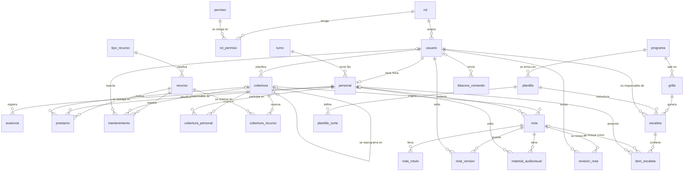

# canal11-pipeline

Sistema de Gestión de Operaciones y Noticias del Canal 11 (TVU-UAGRM), operado por correo electrónico, con arquitectura de **tubería y filtros** (*pipes and filters*).
Proyecto 1 de Tecnología Web (INF513) — Grupo 14 SA — Semestre II-2026.

Es la segunda versión de `canal11-mail`: las mismas reglas de negocio y la misma base de datos, con el flujo de cada correo partido en etapas y los **58 comandos esenciales** de los 8 casos de uso.

## Qué hace

Un usuario del canal envía un correo a `grupo14sa@tecnoweb.org.bo` con un comando en el asunto:

```
LISCOB["2026-10-12"]
```

El sistema lee el buzón por POP3, pasa el correo por la tubería y le responde por SMTP con el resultado en HTML. Si el asunto es `AYUDA`, responde con los comandos que puede usar el rol del remitente.

## Cómo está armado

```
MailVerificationThread ──▶ Decodificar ▶ Filtrar ▶ Identificar ▶ Interpretar ▶ Ayuda
      (fuente, POP3)                                                            │
                                                                                ▼
SendEmailThread ◀── Responder ◀── Registrar ◀── Ejecutar ◀── Validar ◀── Autorizar
 (sumidero, SMTP)
```

| Etapa | Qué hace | Si encuentra un problema |
|---|---|---|
| 1. Decodificar | Lee el MIME: remitente, asunto, cuerpo sin firma ni citas, Message-ID | Nunca falla: lo ilegible queda vacío |
| 2. Filtrar | Descarta rebotes, respuestas automáticas y correos propios; detecta los de más de 1 MB | Descarta sin responder, o responde «no se aceptan adjuntos» |
| 3. Identificar | Abre la conexión a la base y busca al remitente | «Intente más tarde» si la base no responde |
| 4. Interpretar | Separa el código y los parámetros del asunto y busca la ficha del comando | Formato con ejemplo, o «comando no reconocido» |
| 5. Ayuda | Responde AYUDA con los comandos del rol | «No está registrado» |
| 6. Autorizar | Remitente activo y rol con permiso (R1) | «No tiene permiso para ejecutar …» |
| 7. Validar | Cantidad y tipo de los parámetros | Qué parámetro está mal, con el ejemplo |
| 8. Ejecutar | La acción del comando, en una transacción | Se deshace todo y se responde el error traducido |
| 9. Registrar | La bitácora, también de los rechazados (corre siempre) | Se anota en el log |
| 10. Responder | Arma la respuesta en HTML base64 y la encola (corre siempre) | Se anota en el log |

El orden completo está en `Pipeline.completo(...)`. Cada etapa es una clase de `pipeline/etapas` y tiene sus pruebas.

## Los 58 comandos

| Caso de uso | Comandos |
|---|---|
| CU-01 Usuarios (8) | LISUSU INSUSU UPDUSU DELUSU · LISROL · LISRPM INSRPM DELRPM |
| CU-02 Personal (8) | LISPER INSPER UPDPER DELPER · LISTUR · LISAUS INSAUS · DISPER |
| CU-03 Recursos (9) | LISREC INSREC UPDREC DELREC · INCREC ALTREC · LISPRE INSPRE DEVPRE |
| CU-04 Coberturas (10) | LISCOB INSCOB UPDCOB DELCOB · INSCPE DELCPE · INSCRE DELCRE · HOJCOB RETCOB |
| CU-05 Notas (8) | LISNOT INSNOT UPDNOT DELNOT · GUINOT · ENVNOT APRNOT OBSNOT |
| CU-06 Programación y escaleta (10) | LISPRG INSPRG · LISGRI INSGRI · LISESC INSESC UPDESC · INSITE DELITE · EXPESC |
| CU-07 Analítica (2) | ANAPER ANACOB |
| CU-08 Reportes (3) | REPCOB REPREC LISBIT |

Los catálogos de apoyo (roles, turnos, tipos de recurso, plantillas y cortes) vienen cargados en `db/datos_prueba.sql`. El porqué de cada decisión está en [docs/DECISIONES.md](docs/DECISIONES.md).

## Base de datos

PostgreSQL, con **26 tablas** y 8 vistas. `db/script_db_grupo14sa.sql` crea todo (antes borra lo que haya) y `db/datos_prueba.sql` carga los roles, los permisos, los catálogos de apoyo y datos de ejemplo. En el servidor, `scripts/cargar-bd.sh` corre los dos. Todas las consultas del sistema usan `PreparedStatement`.

| Caso de uso | Tablas |
|---|---|
| CU-01 Usuarios | `rol`, `usuario`, `permiso`, `rol_permiso` |
| CU-02 Personal | `turno`, `personal`, `ausencia` |
| CU-03 Recursos | `tipo_recurso`, `recurso`, `prestamo`, `mantenimiento` |
| CU-04 Coberturas | `cobertura`, `cobertura_personal`, `cobertura_recurso` |
| CU-05 Notas | `nota`, `nota_rotulo`, `nota_version`, `revision_nota`, `material_audiovisual` |
| CU-06 Programación y escaleta | `programa`, `grilla`, `plantilla`, `plantilla_corte`, `escaleta`, `item_escaleta` |
| Bitácora (RNF-24) | `bitacora_comando` |

Vistas: `v_ocupacion_personal` y `v_ocupacion_recurso` (choques de horario), `v_nota_duracion` (duración estimada), `v_plantilla_bloque` y `v_plantilla_control` (bloques y control R18), `v_escaleta_grilla` y `v_bloque_balance` (tiempos de la escaleta) y `v_grilla_semanal`.

Relaciones (cada tabla tiene `id` como clave primaria; las líneas son las claves foráneas):



El diseño conceptual (MER), el lógico y el físico, con todas las columnas y restricciones, están en la sección 3.2 del documento técnico.

## Requisitos

| Herramienta | Para qué |
|---|---|
| JDK 17 o superior | Compilar y correr |
| PostgreSQL | Base de datos (en el servidor: `db_grupo14sa`) |
| Acceso SSH a `www.tecnoweb.org.bo` | Subir y correr la aplicación |

Maven no hace falta: el repositorio trae el Maven Wrapper (`./mvnw`).

## Compilar y probar

```bash
./mvnw verify
```

Deja un solo jar con todo adentro en `target/canal11-pipeline.jar`.

Las pruebas marcadas `@Tag("bd")` necesitan un PostgreSQL y se saltan solas si no lo hay. Para correrlas:

```bash
createdb db_grupo14sa_test
```

```bash
export CANAL11_BD_PRUEBA_URL=jdbc:postgresql://localhost:5432/db_grupo14sa_test CANAL11_BD_PRUEBA_USUARIO=postgres CANAL11_BD_PRUEBA_CONTRASENA=
```

```bash
./mvnw verify
```

La primera prueba carga `db/script_db_grupo14sa.sql` y `db/datos_prueba.sql`, y cada prueba deshace sus cambios. Como el script **borra todas las tablas**, solo se acepta una base con «test» en el nombre.

## Configurar y correr

```bash
cp config.example.properties config.properties
```

Completar `config.properties` con las contraseñas del buzón y de la base de datos. No se versiona; en el servidor, darle permisos `600`.

```bash
java -Duser.timezone=America/La_Paz -jar target/canal11-pipeline.jar config.properties
```

Corre una sola copia (bloqueo en `canal11.lock`). Se detiene con Ctrl+C o `kill`: termina el correo en curso y envía las respuestas pendientes. El despliegue en el servidor está en [docs/despliegue.md](docs/despliegue.md).

## Estructura

```
canal11-pipeline/
├── docs/              decisiones y guía de despliegue
├── db/                script de la BD, datos de prueba, consultas y pruebas de integridad
├── scripts/           subir, verificar el servidor, cargar la BD, arrancar, detener y ver el estado
└── src/main/java/bo/edu/uagrm/ficct/canal11/
    ├── App.java           arma la tubería y arranca la fuente y el sumidero
    ├── config/            configuración, log y bloqueo de una sola copia
    ├── correo/            POP3 y SMTP por socket, lectura y armado de MIME
    ├── pipeline/          Pedido, Etapa, Pipeline, la fuente y el sumidero
    │   └── etapas/        las 10 etapas
    ├── comandos/          ficha, contexto y resultado de los comandos
    │   ├── catalogo/      parámetros con su tipo y ejemplo
    │   └── cu01 … cu08/   los comandos de cada caso de uso
    └── datos/             conexión, repositorio, CRUD genérico, bitácora y traductor de errores
```

Los paquetes no tienen ciclos: `config ← datos ← comandos ← pipeline`, y `correo` va aparte.

## Cómo se trabaja

- `main` recibe solo las entregas.
- Se trabaja en ramas `feat/`, `fix/`, `chore/` o `docs/` que salen de `develop`.
- Cada rama vuelve a `develop` con `git merge --no-ff`, después de que pasan las pruebas.
